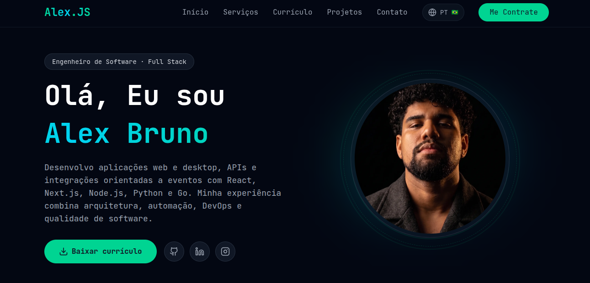
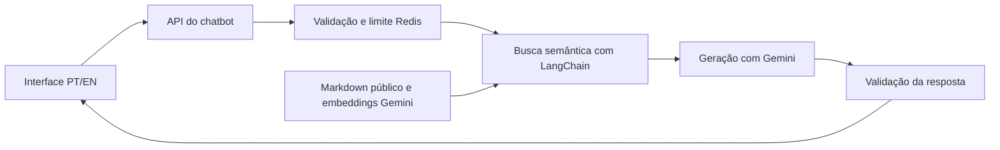

# Portfólio Alexandrino Dev

[](https://github.com/alexandrinodev/portfolio/actions/workflows/deploy.yml)


Portfólio pessoal desenvolvido com Next.js e TypeScript, com interface em português e inglês, assistente de IA com busca semântica e deploy automatizado em VPS.

[Acessar Site em Produção](https://alexalexandrino.cloud/pt) · [Ver versão em inglês](https://alexalexandrino.cloud/en)



## Sobre o projeto

Desenvolvi este projeto para apresentar minha trajetória e minhas entregas como Engenheiro de Software Full Stack. Além da interface, implementei a API do assistente, a recuperação de conhecimento com LangChain e Gemini, os limites de uso com Redis, os testes automatizados e o pipeline de publicação na VPS Hostinger.

## Funcionalidades

- Páginas de apresentação, serviços, currículo e projetos profissionais.
- Navegação em português e inglês, com preferência de idioma salva em cookie.
- Interface responsiva com animações e download do currículo.
- Contato direto pelo WhatsApp e acesso aos perfis profissionais.
- **Alex AI:** assistente sobre meu perfil profissional, com histórico limitado e instrução de resposta no idioma da página.
- Cancelamento de consultas ao fechar o chat e recuperação da pergunta após falhas.

## Tecnologias utilizadas

| Área | Tecnologias |
|---|---|
| Aplicação | Next.js 16, React 19 e TypeScript |
| Interface | Tailwind CSS 4, Framer Motion, Lucide React e React Icons |
| IA e recuperação | Gemini, LangChain e Vercel AI SDK |
| Limites de uso | Upstash Redis |
| Qualidade | ESLint e testes com o runner nativo do Node.js |
| Infraestrutura | Node.js 24, Docker, Docker Compose, Nginx e VPS Hostinger |
| Entrega contínua | GitHub Actions e SSH |

## Arquitetura e decisões técnicas

O Next.js reúne as páginas e a rota de servidor `POST /api/chat`. A interface envia pergunta, idioma e histórico; o servidor valida a entrada, controla o uso e recupera trechos da base pública antes de consultar o Gemini.



| Decisão | Motivação e consequência |
|---|---|
| **RAG sobre uma base pública em Markdown** | Selecionar trechos relevantes para a pergunta, em vez de enviar toda a base em cada consulta |
| **Índice vetorial em memória** | Atender à base pequena sem um banco vetorial externo; reinícios podem exigir nova indexação |
| **Validação antes da exibição** | Liberar a resposta somente após verificar conclusão, formato e filtros de saída; o texto não aparece progressivamente durante a geração |
| **Contadores globais no Redis** | Compartilhar limites entre visitantes e instâncias; o Redis armazena contadores, sem perguntas ou respostas |
| **Separação entre regras e dados** | Tratar pergunta, histórico e trechos recuperados como dados não confiáveis, com filtros de entrada e saída |

Sem trechos aprovados, o assistente informa que não possui a informação e não chama a geração. Os filtros de segurança podem apresentar falsos positivos ou ser contornados; a precisão factual e a economia de tokens com RAG ainda precisam ser avaliadas com o modelo real.

A implementação separa contratos, recuperação, geração, cache e transporte em módulos, permitindo testes sem acesso aos serviços externos. Detalhes em [arquitetura do chatbot](docs/CHATBOT_ARCHITECTURE.md) e [segurança](docs/CHATBOT_SECURITY.md).

## Qualidade e testes

A suíte do chatbot usa HTTP simulado e credenciais fictícias, sem consumir cotas de Gemini ou Redis. Cobre contratos HTTP, histórico, recuperação, invalidação de cache, concorrência, cancelamento, limites de uso e guardrails de entrada e saída.

```bash
npm run lint
npm run test:chatbot
npm run build
```

Os testes verificam também as instruções de idioma enviadas ao provedor. A qualidade das respostas do Gemini real exige uma avaliação separada.

Para inspecionar a recuperação com embeddings reais:

```bash
npm run inspect:rag -- "Qual a experiência de Alex com Python?"
```

Esse comando mostra trechos e pontuações, consome cota de embeddings e não gera uma resposta.

## CI/CD e hospedagem

Implementei o deploy na VPS Hostinger com GitHub Actions, Docker Compose e Nginx com HTTPS. O pipeline de publicação foi executado com sucesso.

| Evento | Comportamento |
|---|---|
| Pull request para `master` | Executa lint, testes e build Docker |
| Push na `master` | Executa as verificações, transfere a imagem por SSH e atualiza o container |
| Execução manual na `master` | Executa o mesmo fluxo de verificações e deploy |

O Dockerfile usa múltiplos estágios, Node.js 24 e Next.js standalone. A imagem final executa com usuário sem privilégios de root, recebe o SHA do commit como tag e carrega as credenciais na execução, diretamente da VPS.

O Nginx encaminha as conexões HTTPS ao container pela porta local `3000`. O deploy aguarda o healthcheck de `/pt` e tenta restaurar a versão anterior se a nova falhar. A atualização de um único container pode causar uma breve interrupção; o healthcheck interno não valida DNS, HTTPS nem os serviços externos.

Implementação: [workflow](.github/workflows/deploy.yml), [Dockerfile](Dockerfile), [Compose](compose/docker-compose.yml) e [script de deploy](scripts/deploy-vps.sh). Configuração e operação estão no [guia da VPS](docs/DEPLOY_VPS.md).

## Execução local

Requisitos: **Node.js 24.x** e npm.

```bash
git clone https://github.com/alexandrinodev/portfolio.git
cd portfolio
npm ci
cp .env.example .env.local
npm run dev
```

Abra [localhost:3000/pt](http://localhost:3000/pt) ou [localhost:3000/en](http://localhost:3000/en).

Para ativar o chatbot, preencha `GEMINI_API_KEY` e `GEMINI_MODEL` em `.env.local`. Os demais parâmetros estão no [arquivo de exemplo](.env.example) e no [guia da API](docs/CHATBOT_API.md). Para explorar apenas o portfólio, configure `CHATBOT_ENABLED=false`.

Em desenvolvimento, o contador pode funcionar em memória sem Redis. Em produção, as credenciais Upstash são necessárias para o chatbot. Reinicie o servidor após alterar as variáveis de ambiente.

## Organização do código

| Caminho | Responsabilidade |
|---|---|
| `src/app/[lang]/` | Páginas em português e inglês |
| `src/components/` | Componentes da interface, incluindo o chat |
| `src/app/api/chat/` | Contrato HTTP e transporte das respostas |
| `src/app/lib/chatbot/` | Recuperação, geração, cache, validação e controle de uso |
| `tests/` | Testes automatizados do chatbot |
| `.github/`, `compose/` e `scripts/deploy-vps.sh` | Pipeline e execução na VPS |

## Documentação

- [Arquitetura e decisões do chatbot](docs/CHATBOT_ARCHITECTURE.md).
- [Contrato da API, configuração e diagnóstico](docs/CHATBOT_API.md).
- [Segurança, guardrails e limites das proteções](docs/CHATBOT_SECURITY.md).
- [Deploy na VPS, secrets e operação](docs/DEPLOY_VPS.md).
- [Histórico da implementação do chatbot](docs/CHATBOT_IMPLEMENTATION_PLAN.md).
- [Base pública de conhecimento](docs/alex_portfolio_knowledge_public.md).

## Autor

**Alex Alexandrino — Engenheiro de Software Full Stack**

[GitHub](https://github.com/alexandrinodev) · [LinkedIn](https://www.linkedin.com/in/alexandrino-alex) · [E-mail](mailto:alexbrunoalexandrino@gmail.com)
