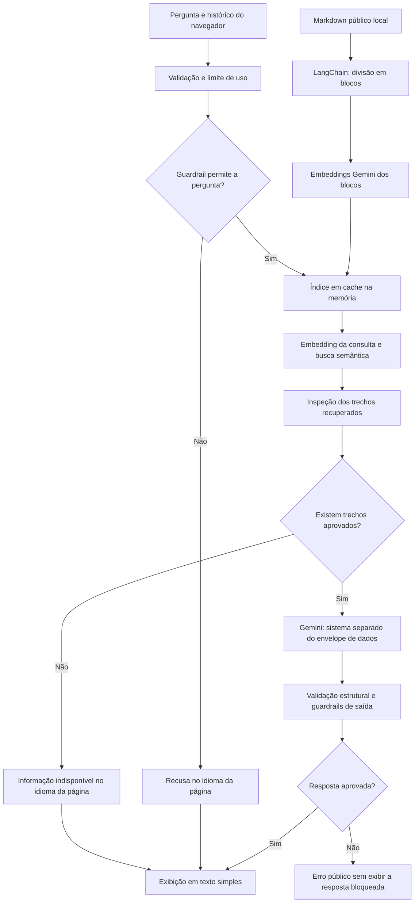

# 🚀 Portfolio Alexandrino Dev

<div align="center">


**Portfolio pessoal moderno e responsivo construído com Next.js 16, React 19 e Tailwind CSS.**

</div>

---

## ✨ Sobre o Projeto

Este é meu portfolio pessoal, desenvolvido para apresentar meus projetos, habilidades e experiência como Desenvolvedor Full Stack. O site conta com animações, layout responsivo, páginas em português e inglês e um assistente de IA que consulta uma base pública sobre minha trajetória.

### 🎯 Funcionalidades

- 🏠 **Página Inicial** - Apresentação profissional com estatísticas animadas
- 💼 **Serviços** - Descrição dos serviços oferecidos (Full Stack, APIs, Automação e Qualidade)
- 📋 **Currículo** - Experiências, educação, habilidades e sobre mim
- 🖥️ **Projetos** - Entregas profissionais descritas no currículo
- 📧 **Contato** - Contato direto via WhatsApp
- 🤖 **Alex AI** - Chatbot sobre o perfil profissional, com respostas em português e inglês

### ⚡ Tecnologias

<div align="center">

| Categoria | Tecnologias |
|-----------|-------------|
| **Frontend** | React, Next.js 16, TypeScript |
| **Estilização** | Tailwind CSS, Framer Motion |
| **Ícones** | React Icons, Lucide React |
| **Contato** | WhatsApp |
| **Chatbot** | LangChain, embeddings Gemini, Vercel AI SDK e Upstash Redis |
| **Linting** | ESLint |

</div>

### 🛠️ Stack de Habilidades

<div align="center">

#### Frontend


#### Backend


#### DevOps & Tools


</div>

---

## 🤖 Como o chatbot responde

O **Alex AI** usa RAG (recuperação de trechos seguida de geração) sobre um arquivo Markdown local. O LangChain faz a divisão do documento e a busca no índice em memória. Os embeddings e as respostas vêm do Google Gemini, com conexão direta pelo Vercel AI SDK, sem AI Gateway ou banco vetorial externo.



### Preparação e cache do índice

O servidor lê somente [`docs/alex_portfolio_knowledge_public.md`](docs/alex_portfolio_knowledge_public.md) como fonte de fatos e cria documentos LangChain. O `RecursiveCharacterTextSplitter` usa separadores Markdown, blocos de até 1.100 caracteres e sobreposição de até 150 caracteres. Cada bloco recebe a origem e um identificador.

Um adaptador da interface `Embeddings` do LangChain usa o modelo de `GEMINI_EMBEDDING_MODEL` (padrão: `gemini-embedding-001`), com tarefas `RETRIEVAL_DOCUMENT` para os blocos e `RETRIEVAL_QUERY` para a consulta. O `MemoryVectorStore` armazena os vetores e realiza busca por similaridade cosseno.

O índice é construído sob demanda e reutilizado pela instância. A chave do cache considera o conteúdo do Markdown, o modelo, a credencial e os parâmetros da divisão. Alterações invalidam o índice; requisições simultâneas à mesma versão compartilham sua construção. Uma construção que falha é descartada para permitir nova tentativa.

Na Vercel, esse cache é **local à instância e temporário**. Um cold start ou novo deploy pode gerar novamente os embeddings dos documentos, consumindo tempo e cota. O índice não é compartilhado pelo Redis, não fica em banco externo e não é gerado durante o build. A chave `GEMINI_API_KEY` permanece somente no servidor.

### Recuperação, geração e exibição

1. A interface usa `useChat()` e envia a pergunta, o idioma da página e um histórico limitado para `POST /api/chat`. O cliente preserva até cinco pares anteriores, dentro dos limites de tamanho.
2. A API valida o corpo e consulta os limites globais no Upstash Redis. Depois inspeciona sinais explícitos de prompt injection na pergunta e remove pares suspeitos do histórico, antes de acessar embeddings ou geração. Uma pergunta bloqueada recebe recusa local. O Redis armazena contadores, sem perguntas ou respostas.
3. O servidor obtém o índice e gera o embedding da consulta. Para continuações reconhecidas por uma regra simples, combina a pergunta atual com a pergunta anterior do visitante; não faz uma chamada extra ao modelo para reescrevê-la.
4. A busca obtém até oito candidatos. A inspeção verifica origem, correspondência com os blocos indexados, score finito, similaridade mínima, duplicatas, orçamento e sinais explícitos de injeção. São enviados até quatro blocos, somando no máximo 4.400 caracteres de texto. `CHATBOT_RAG_MIN_SCORE` define o limiar inicial (padrão: `0.35`), que precisa ser calibrado com perguntas reais em português e inglês.
5. Sem trechos aprovados, o assistente informa que não possui a informação e não chama o modelo de geração. Caso contrário, as regras de [`docs/alex_ai_system_prompt.md`](docs/alex_ai_system_prompt.md) vão na instrução de sistema; uma mensagem JSON `portfolio_question` contém os campos `reference`, `history` e `question`. Os trechos, com origem, identificador e texto, ficam em `reference.passages`. Todo o histórico é dado não autenticado, sem criar papéis reais de assistente no pedido ao modelo.
6. O idioma de resposta é sempre o da página: português em `/pt` e inglês em `/en`, mesmo quando a pergunta, o histórico ou a base estão em outro idioma. Essa regra também se aplica à resposta de informação indisponível. O Gemini gera a resposta com raciocínio `low` e teto de 1.024 tokens de saída. O servidor aguarda o texto completo e valida conclusão normal, conteúdo não vazio, tamanho e ausência de HTML e caracteres de controle inválidos. A resposta também passa pelos guardrails de saída descritos abaixo. Só então o texto é enviado à interface. Essas verificações não comprovam automaticamente que todos os fatos estejam corretos.

O protocolo SSE do AI SDK continua sendo usado pela interface, mas o texto só é liberado **depois da validação completa**, sem exibição progressiva de uma resposta ainda não validada. A interface renderiza o texto diretamente, sem interpretar HTML ou Markdown. Fechar o painel cancela a requisição; falhas restauram a pergunta para nova tentativa. Recarregar a página inicia uma nova conversa.

### Organização do código

Os módulos em `src/app/lib/chatbot/` separam o fluxo do chat dos detalhes de infraestrutura:

| Módulo | Responsabilidade |
|---|---|
| `contracts.ts` | Tipos, limites compartilhados, códigos de erro e validações |
| `config.ts` | Configurações de servidor e leitura validada das variáveis de ambiente |
| `provider.ts` | Coordenar recuperação e geração para responder à pergunta |
| `prompt.ts` | Montar a consulta de recuperação e separar instruções dos dados |
| `generation.ts` | Chamar o Gemini, coletar o texto e validar a resposta completa |
| `embeddings.ts` | Adaptar os embeddings Gemini à interface do LangChain |
| `knowledge-index.ts` | Dividir o Markdown, construir o índice e gerenciar seu cache |
| `retrieval.ts` | Buscar candidatos e inspecionar os trechos selecionados |
| `errors.ts` | Traduzir erros do provedor para códigos públicos |
| `guardrails.ts` | Inspecionar pergunta, histórico, trechos e saída para sinais explícitos de injeção |
| `request.ts` / `rate-limit.ts` | Validar HTTP e controlar o uso da aplicação |
| `transport.ts` / `conversation.ts` | Adaptar mensagens da interface e limitar o histórico |

A rota `/api/chat` cuida do contrato HTTP e do transporte da resposta já validada. O cache recebe as dependências de leitura e embeddings pelo construtor, permitindo testar mudanças na base, concorrência e falhas sem acessar serviços externos. Os testes e o comando de inspeção compartilham o resolvedor de imports em `scripts/register-typescript.mjs`.

### Guardrails e prompt injection

Além da validação de formato e do limite Redis, o servidor inspeciona tentativas explícitas de substituir regras, revelar instruções/credenciais ou simular papéis privilegiados. A pergunta atual pode receber recusa local, no idioma da página, antes das chamadas de IA; pares suspeitos do histórico e trechos suspeitos da recuperação são descartados.

Antes da exibição, a resposta também passa por verificações de credenciais conhecidas, cópia de frases internas e links que não aparecem nos trechos aprovados. O modelo não possui ferramentas, execução de comandos ou acesso livre a arquivos e URLs. Os filtros são camadas de mitigação: podem ser contornados ou gerar falsos positivos e não garantem correção factual. Detalhes, testes e limites: [segurança do chatbot](docs/CHATBOT_SECURITY.md).

### Decisão, consumo e inspeção

A versão anterior enviava a base completa em toda pergunta. O RAG foi adotado para selecionar informações relevantes e reduzir os tokens de contexto enviados à geração. O índice em memória atende ao volume pequeno do portfólio sem contratar um banco vetorial. Em contrapartida, cada consulta passa a consumir embeddings, e cada nova instância pode precisar indexar a base novamente. As instruções e o histórico continuam consumindo tokens; o teto de saída não é um consumo fixo.

Os logs `[chatbot] retrieval` mostram IDs, pontuações e tamanho do contexto, sem imprimir perguntas ou trechos. `[chatbot] tokens` registra o uso de geração informado pelo provedor, incluindo raciocínio e cache quando disponíveis. Esses valores não incluem o consumo dos embeddings. `[chatbot] guardrail` registra apenas etapa e decisão de bloqueio. `[chatbot] latency` mede indexação, embedding da consulta, busca, contexto, primeiro texto do provedor e validação. O primeiro texto do provedor não corresponde ao primeiro texto visível, pois a resposta é validada antes da exibição.

A seção de testes abaixo explica como executar a suíte simulada e inspecionar a recuperação com embeddings reais.

A economia de tokens e a qualidade da recuperação ainda precisam ser medidas com o modelo real. Perguntas amplas podem exigir trechos que não entram entre os quatro selecionados. O RAG não garante eliminar a latência do Gemini nem impedir respostas incorretas.

Detalhes de configuração e contratos: [`docs/CHATBOT_API.md`](docs/CHATBOT_API.md).

---

## 🚀 Começando

### Pré-requisitos

- Node.js 24.x (inclui suporte à execução dos testes e do comando de inspeção)
- npm, yarn, pnpm ou bun

### Instalação

```bash
# Clone o repositório
git clone https://github.com/alexandrinodev/portfolio.git

# Entre no diretório
cd portfolio

# Instale as dependências
npm install
# ou
yarn install
# ou
pnpm install
# ou
bun install
```

### Configuração do chatbot

Copie o arquivo de exemplo para criar sua configuração local:

```bash
cp .env.example .env.local
```

Preencha os valores no arquivo `.env.local`, que fica fora do versionamento:

| Variável | Uso | Obrigatoriedade ou padrão |
|---|---|---|
| `GEMINI_API_KEY` | Chave do Google usada no servidor | Necessária para embeddings e geração |
| `GEMINI_MODEL` | Modelo de geração habilitado para a chave | Necessário; sem valor padrão |
| `GEMINI_EMBEDDING_MODEL` | Modelo usado para blocos e consultas | `gemini-embedding-001` |
| `CHATBOT_RAG_MIN_SCORE` | Similaridade mínima para selecionar trechos | `0.35`; calibrar com perguntas PT/EN |
| `CHATBOT_ENABLED` | Permite desligar a API do chatbot | `false` desativa; ativa quando ausente |
| `CHATBOT_REQUESTS_PER_MINUTE` | Limite global de consultas por minuto | `5` |
| `CHATBOT_REQUESTS_PER_DAY` | Limite global de consultas por dia | `50` |
| `UPSTASH_REDIS_REST_URL` | Endpoint REST do Redis compartilhado | Necessário em produção e Preview |
| `UPSTASH_REDIS_REST_TOKEN` | Token Redis com permissão de escrita | Necessário em produção e Preview |

Somente em desenvolvimento local, sem as duas credenciais Redis, o contador funciona em memória e reinicia com o processo. Se configurar Redis localmente, forneça as duas variáveis. Ambientes que usam o mesmo Redis compartilham os contadores globais da aplicação.

O portfólio pode ser desenvolvido sem configurar o Gemini; nesse caso, consultas normais ao chatbot ficam indisponíveis. A aplicação utiliza diretamente a API do Google: não é necessário configurar `AI_GATEWAY_API_KEY` nem contratar um banco vetorial. Embeddings e geração continuam sujeitos às cotas e à cobrança do projeto Google.

### Executando em Desenvolvimento

```bash
# Inicie o servidor de desenvolvimento
npm run dev
# ou
yarn dev
# ou
pnpm dev
# ou
bun dev
```

Abra [a página em português](http://localhost:3000/pt) ou [a página em inglês](http://localhost:3000/en). A raiz `/` redireciona para o idioma salvo ou português. Reinicie o servidor após alterar as variáveis de ambiente.

### Build para Produção

```bash
# Crie a build de produção
npm run build

# Inicie o servidor de produção
npm run start
```

### Testes e verificações

```bash
npm run lint
npm run test:chatbot
npm run build
```

A suíte do chatbot usa HTTP simulado e credenciais fictícias, sem consumir cota Gemini ou Redis. Ela cobre contratos da API, histórico, idiomas da página, recuperação, cache, concorrência, cancelamento e guardrails de entrada e saída. Os testes de idioma verificam a instrução enviada ao modelo e as respostas locais; não comprovam a obediência do Gemini real.

Para avaliar a busca com embeddings reais:

```bash
npm run inspect:rag -- "Qual a experiência de Alex com Python?"
```

A inspeção consome cota, mostra os trechos públicos e suas pontuações e não gera uma resposta. A avaliação de qualidade e de resistência a ataques com o modelo real é uma etapa separada dos testes simulados.

### Deploy na Vercel

Cadastre as variáveis no projeto, em **Settings → Environment Variables**, para os ambientes **Production** e **Preview** que utilizar. Use os nomes da tabela acima, sem prefixo `NEXT_PUBLIC_`. Depois de cadastrar ou alterar os valores, publique um novo deployment.

A API exige Redis compartilhado nesses ambientes; configuração ausente ou falha no Redis retorna indisponibilidade antes de consultar a IA. O deploy inclui somente a base pública e o prompt nos arquivos necessários da função `/api/chat`, conforme `next.config.ts`. O índice vetorial é construído em memória na instância e pode precisar ser refeito em cold starts.

### Documentação técnica

- [Contrato da API, configuração e diagnóstico](docs/CHATBOT_API.md).
- [Guardrails, prompt injection e limites das proteções](docs/CHATBOT_SECURITY.md).
- [Histórico das decisões de implementação](docs/CHATBOT_IMPLEMENTATION_PLAN.md).
- [Base pública usada pelo chatbot](docs/alex_portfolio_knowledge_public.md).
- [Instruções de comportamento do assistente](docs/alex_ai_system_prompt.md).

---

## 📁 Estrutura do Projeto

```text
portfolio/
├── docs/
│   ├── alex_portfolio_knowledge_public.md  # Fonte pública de fatos
│   ├── alex_ai_system_prompt.md           # Instruções do assistente
│   ├── CHATBOT_API.md                     # Contrato e configuração da API
│   └── CHATBOT_SECURITY.md                # Controles e limites de segurança
├── public/                               # Imagens e ícones
├── scripts/
│   ├── inspect-rag.mjs                    # Inspeção com embeddings reais
│   └── register-typescript.mjs            # Imports TypeScript fora do Next.js
├── src/
│   ├── app/
│   │   ├── [lang]/                       # Páginas localizadas em pt/en
│   │   │   ├── contact/page.tsx
│   │   │   ├── resume/page.tsx
│   │   │   ├── services/page.tsx
│   │   │   ├── work/page.tsx
│   │   │   ├── layout.tsx
│   │   │   └── page.tsx
│   │   ├── api/chat/route.ts              # Endpoint do chatbot
│   │   ├── i18n/                         # Contexto e traduções
│   │   ├── lib/
│   │   │   ├── chatbot/                  # RAG, geração, cache e guardrails
│   │   │   └── constants.tsx             # Dados do portfólio
│   │   └── globals.css
│   ├── components/                       # Interface, incluindo Chatbot.tsx
│   └── proxy.ts                          # Redirecionamento de idioma
├── tests/                                # Conversa, domínio, API e guardrails
├── .env.example                          # Configuração sem credenciais reais
├── next.config.ts
├── package.json
└── package-lock.json
```

---

## 📊 Estatísticas

<div align="center">

| Métrica | Valor |
|---------|-------|
| Anos no ciclo de desenvolvimento | 5 |
| Anos em aplicações web e desktop | 4 |
| Redução no tempo de execução de fluxos automatizados | Até 60% |
| Idiomas | Português nativo e inglês B2 |

</div>

---

## 👨‍💻 Sobre Mim

Sou **Alex Alexandrino**, Engenheiro de Software Full Stack com 5 anos no ciclo de desenvolvimento de software e 4 anos dedicados a aplicações web e desktop. Atuei no SIDIA como **Tester Engineer (2022–2023)** e **Software Engineer (2023–2026)**, trabalhando com arquitetura orientada a eventos, APIs, automação, DevOps e qualidade.

Minha formação inclui Ciência da Computação na UNINORTE (2017–2020), AOSP no Icomp/UFAM (2024–2025) e pós-graduação em Engenharia de Software com IA Aplicada na UNIPDS, em andamento com conclusão prevista para outubro de 2027.

**Idiomas:** Português nativo e inglês B2.

**Interesses:** Arquitetura de software, automação, IA aplicada e qualidade de software.

---

## 📬 Contato

<div align="center">

[](mailto:alexbrunoalexandrino@gmail.com)
[](https://github.com/alexandrinodev)
[](https://linkedin.com/in/alexandrino-alex)
[](https://instagram.com/oalexandrino_/)

</div>

---

## 📝 Licença

Este projeto está sob a licença MIT. Veja o arquivo [LICENSE](LICENSE) para mais detalhes.

---

<div align="center">

**Desenvolvido com 💚 por [Alex Alexandrino](https://github.com/alexandrinodev)**

</div>
