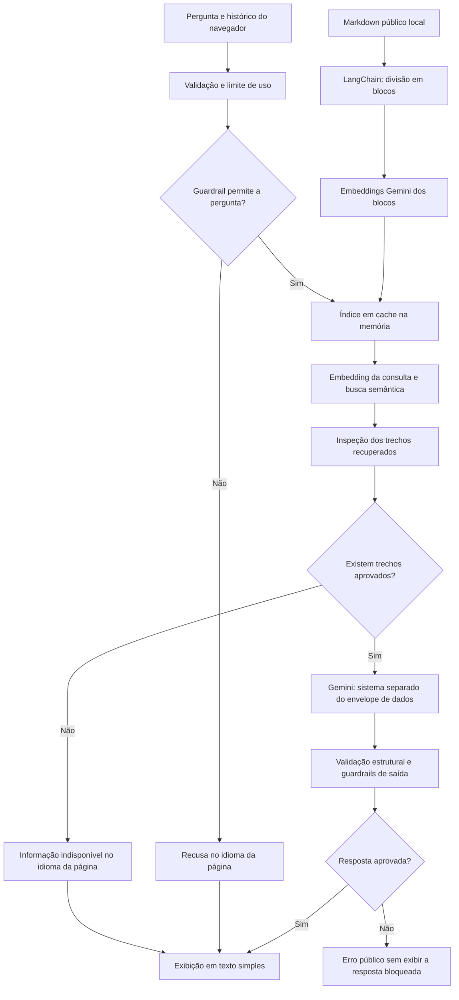

# Arquitetura do chatbot Alex AI

O **Alex AI** usa RAG (recuperação de trechos seguida de geração) sobre um arquivo Markdown local. O LangChain faz a divisão do documento e a busca no índice em memória. Os embeddings e as respostas vêm do Google Gemini, com conexão direta pelo Vercel AI SDK, sem AI Gateway ou banco vetorial externo.

### Preparação e cache do índice

O servidor lê somente [`docs/alex_portfolio_knowledge_public.md`](alex_portfolio_knowledge_public.md) como fonte de fatos e cria documentos LangChain. O `RecursiveCharacterTextSplitter` usa separadores Markdown, blocos de até 1.100 caracteres e sobreposição de até 150 caracteres. Cada bloco recebe a origem e um identificador.

Um adaptador da interface `Embeddings` do LangChain usa o modelo de `GEMINI_EMBEDDING_MODEL` (padrão: `gemini-embedding-001`), com tarefas `RETRIEVAL_DOCUMENT` para os blocos e `RETRIEVAL_QUERY` para a consulta. O `MemoryVectorStore` armazena os vetores e realiza busca por similaridade cosseno.

O índice é construído sob demanda e reutilizado pela instância. A chave do cache considera o conteúdo do Markdown, o modelo, a credencial e os parâmetros da divisão. Alterações invalidam o índice; requisições simultâneas à mesma versão compartilham sua construção. Uma construção que falha é descartada para permitir nova tentativa.

O cache é **local ao processo e temporário**. Na VPS, ele é reutilizado enquanto o processo do container permanecer ativo; reinícios e novos deploys podem gerar novamente os embeddings dos documentos, consumindo tempo e cota. Na Vercel, isso também pode ocorrer em cold starts. O índice não é compartilhado pelo Redis, não fica em banco externo e não é gerado durante o build. A chave `GEMINI_API_KEY` permanece somente no servidor.

### Recuperação, geração e exibição

1. A interface usa `useChat()` e envia a pergunta, o idioma da página e um histórico limitado para `POST /api/chat`. O cliente preserva até cinco pares anteriores, dentro dos limites de tamanho.
2. A API valida o corpo e consulta os limites globais no Upstash Redis. Depois inspeciona sinais explícitos de prompt injection na pergunta e remove pares suspeitos do histórico, antes de acessar embeddings ou geração. Uma pergunta bloqueada recebe recusa local. O Redis armazena contadores, sem perguntas ou respostas.
3. O servidor obtém o índice e gera o embedding da consulta. Para continuações reconhecidas por uma regra simples, combina a pergunta atual com a pergunta anterior do visitante; não faz uma chamada extra ao modelo para reescrevê-la.
4. A busca obtém até oito candidatos. A inspeção verifica origem, correspondência com os blocos indexados, score finito, similaridade mínima, duplicatas, orçamento e sinais explícitos de injeção. São enviados até quatro blocos, somando no máximo 4.400 caracteres de texto. `CHATBOT_RAG_MIN_SCORE` define o limiar inicial (padrão: `0.35`), que precisa ser calibrado com perguntas reais em português e inglês.
5. Sem trechos aprovados, o assistente informa que não possui a informação e não chama o modelo de geração. Caso contrário, as regras de [`docs/alex_ai_system_prompt.md`](alex_ai_system_prompt.md) vão na instrução de sistema; uma mensagem JSON `portfolio_question` contém os campos `reference`, `history` e `question`. Os trechos, com origem, identificador e texto, ficam em `reference.passages`. Todo o histórico é dado não autenticado, sem criar papéis reais de assistente no pedido ao modelo.
6. O modelo é instruído a responder no idioma da página: português em `/pt` e inglês em `/en`, mesmo quando a pergunta, o histórico ou a base estão em outro idioma. Essa regra também se aplica à resposta de informação indisponível. O Gemini gera a resposta com raciocínio `low` e teto de 1.024 tokens de saída. O servidor aguarda o texto completo e valida conclusão normal, conteúdo não vazio, tamanho e ausência de HTML e caracteres de controle inválidos. A resposta também passa pelos guardrails de saída descritos abaixo. Só então o texto é enviado à interface. Essas verificações não comprovam automaticamente que todos os fatos estejam corretos.

O protocolo SSE do AI SDK continua sendo usado pela interface, mas o texto só é liberado **depois da validação completa**, sem exibição progressiva de uma resposta ainda não validada. A interface renderiza o texto diretamente, sem interpretar HTML ou Markdown. Fechar o painel cancela a requisição; falhas restauram a pergunta para nova tentativa. Recarregar a página inicia uma nova conversa.

### Organização do código

Os módulos em `src/app/lib/chatbot/` separam o fluxo do chat dos detalhes de infraestrutura:

| Módulo | Responsabilidade |
|---|---|
| `contracts.ts` | Tipos, limites compartilhados, códigos de erro e validações |
| `config.ts` | Configurações de servidor e leitura validada das variáveis de ambiente |
| `provider.ts` | Coordenar recuperação e geração para responder à pergunta |
| `prompt.ts` | Montar a consulta de recuperação e separar instruções dos dados |
| `generation.ts` | Chamar o Gemini, coletar o texto e validar a resposta completa |
| `embeddings.ts` | Adaptar os embeddings Gemini à interface do LangChain |
| `knowledge-index.ts` | Dividir o Markdown, construir o índice e gerenciar seu cache |
| `retrieval.ts` | Buscar candidatos e inspecionar os trechos selecionados |
| `errors.ts` | Traduzir erros do provedor para códigos públicos |
| `guardrails.ts` | Inspecionar pergunta, histórico, trechos e saída para sinais explícitos de injeção |
| `request.ts` / `rate-limit.ts` | Validar HTTP e controlar o uso da aplicação |
| `transport.ts` / `conversation.ts` | Adaptar mensagens da interface e limitar o histórico |

A rota `/api/chat` cuida do contrato HTTP e do transporte da resposta já validada. O cache recebe as dependências de leitura e embeddings pelo construtor, permitindo testar mudanças na base, concorrência e falhas sem acessar serviços externos. Os testes e o comando de inspeção compartilham o resolvedor de imports em `scripts/register-typescript.mjs`.

### Guardrails e prompt injection

Além da validação de formato e do limite Redis, o servidor inspeciona tentativas explícitas de substituir regras, revelar instruções/credenciais ou simular papéis privilegiados. A pergunta atual pode receber recusa local, no idioma da página, antes das chamadas de IA; pares suspeitos do histórico e trechos suspeitos da recuperação são descartados.

Antes da exibição, a resposta também passa por verificações de credenciais conhecidas, cópia de frases internas e links que não aparecem nos trechos aprovados. O modelo não possui ferramentas, execução de comandos ou acesso livre a arquivos e URLs. Os filtros são camadas de mitigação: podem ser contornados ou gerar falsos positivos e não garantem correção factual. Detalhes, testes e limites: [segurança do chatbot](CHATBOT_SECURITY.md).

### Decisão, consumo e inspeção

A versão anterior enviava a base completa em toda pergunta. O RAG foi adotado para selecionar informações relevantes e reduzir os tokens de contexto enviados à geração. O índice em memória atende ao volume pequeno do portfólio sem contratar um banco vetorial. Em contrapartida, cada consulta passa a consumir embeddings, e cada nova instância pode precisar indexar a base novamente. As instruções e o histórico continuam consumindo tokens; o teto de saída não é um consumo fixo.

Os logs `[chatbot] retrieval` mostram IDs, pontuações e tamanho do contexto, sem imprimir perguntas ou trechos. `[chatbot] tokens` registra o uso de geração informado pelo provedor, incluindo raciocínio e cache quando disponíveis. Esses valores não incluem o consumo dos embeddings. `[chatbot] guardrail` registra apenas etapa e decisão de bloqueio. `[chatbot] latency` mede indexação, embedding da consulta, busca, contexto, primeiro texto do provedor e validação. O primeiro texto do provedor não corresponde ao primeiro texto visível, pois a resposta é validada antes da exibição.

O [README](../README.md#qualidade-e-testes) apresenta os comandos de teste; o [guia da API](CHATBOT_API.md) detalha a inspeção com embeddings reais.

A economia de tokens e a qualidade da recuperação ainda precisam ser medidas com o modelo real. Perguntas amplas podem exigir trechos que não entram entre os quatro selecionados. O RAG não garante eliminar a latência do Gemini nem impedir respostas incorretas.

Detalhes de configuração e contratos: [`docs/CHATBOT_API.md`](CHATBOT_API.md).

